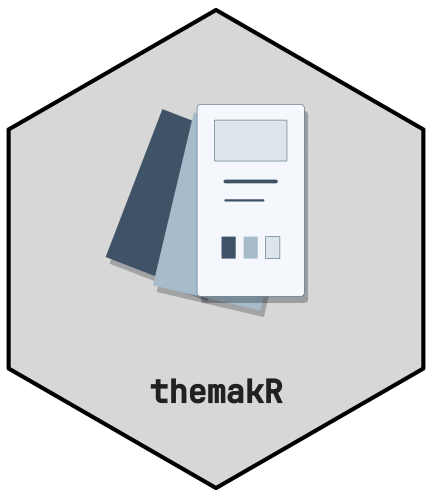
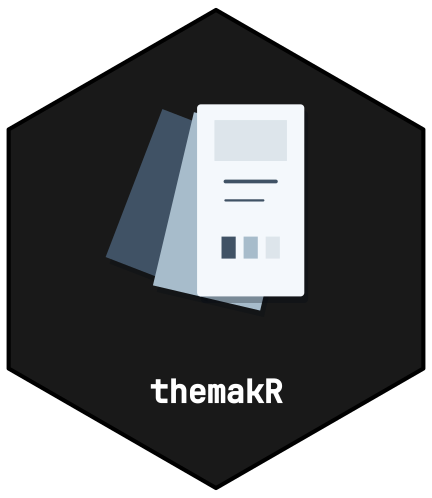

# Adopting themakR



[](https://github.com/CTTIR/themakR/actions/workflows/R-CMD-check.yaml)
[](https://cttir.github.io/themakR/)
[](https://CRAN.R-project.org/package=themakR)
[](https://app.codecov.io/gh/CTTIR/themakR?branch=main)
[](https://cran.r-project.org/package=themakR)
[](https://cran.r-project.org/package=themakR)
[](https://opensource.org/licenses/MIT)
[](https://lifecycle.r-lib.org/articles/stages.html#experimental)

themakR is the pkgdown template for the CTTIR package suite. It gives
every package the same look — the Hugo Coder palette used on [the suite
site](https://cttir.github.io/website/) with light and dark modes, Inter
body text, JetBrains Mono code, a light/dark/auto toggle, the hex
top-left in the navbar, the rotemplate-style navigation and sidebar, and
a shared suite footer — with two lines of configuration. This vignette
is the complete adoption guide.

## 1. Declare the website dependency

Add this line to your package’s `DESCRIPTION`, so the pkgdown GitHub
Action installs themakR before building your site:

    Config/Needs/website: CTTIR/themakR

## 2. Point your site at the template

Add this to your package’s `_pkgdown.yml`:

``` yaml
template:
  package: themakR
development:
  mode: auto
```

That is the whole theme configuration. Colours and colour modes, fonts,
syntax-highlighting themes, the navbar layout (brand far left; Search,
Reference, Articles, Changelog, GitHub, and the light switch grouped on
the right), and the home sidebar are all inherited from themakR.

## 3. Provide your hex

Copy the approved named v5 light hex to `man/figures/logo.svg` and
`man/figures/logo.png`. Copy its dark counterpart to
`man/figures/logo-dark.svg`. These standard aliases are the same artwork
as `logo-with-name.svg`, `logo-with-name.png`, and
`logo-with-name-dark.svg`. The package name belongs inside the lower
part of every branding hex. The live navbar title remains available for
navigation and accessibility.

themakR displays this named hex on every page, including articles,
reference topics, changelog and utility pages. It switches the navbar
and homepage heading artwork with the existing light/dark/auto control.
Packages without the dark asset keep their light logo. The aspect ratio
is preserved at both desktop and mobile navbar sizes.

### Named README lockups

Use the named light/dark hexes in repository README files, vignettes,
package overview pages and figures. In v5, the package name sits inside
the lower part of the hex, below the scientific artwork. The
`logo-with-name` filename identifies this named variant; an extra name
caption is not needed. For example, after copying the corresponding
assets into `man/figures/`:

``` html
<picture class="cttir-readme-logo">
  <source class="cttir-logo-dark-source"
          media="(prefers-color-scheme: dark)"
          srcset="man/figures/logo-with-name-dark.png">
  
</picture>
```

Repository hosts use the system colour preference. On pkgdown pages the
shared enhancement also follows the manual colour-mode switch. When the
picture is inside the README’s first heading, themakR hides it on
pkgdown’s home page because pkgdown already supplies the same named hex
beside that heading. The README picture remains visible on repository
hosts.

### Named figures

The shared stylesheet includes versioned CTTIR v5 tokens and the
`cttir-lockup` component. The component changes only its own
presentation; the site’s existing Bootstrap colours and bslib fonts
remain in charge. For a named figure that follows the current colour
mode:

``` html
<figure class="cttir-lockup" data-cttir-topic="spectral">
  
  
</figure>
```

Adjust image paths for the document’s location. The component displays
only the appropriate light or dark variant. SVG lettering is outlined,
so provide the package name in the image’s `alt` attribute. If a
selectable text caption is needed for a separate artwork illustration,
use an explicitly named artwork-only asset with an empty image
alternative and a `figcaption`. Keep the standard `logo.svg` and
`logo-dark.svg` aliases as named package hexes. Topic colours identify a
package family; they do not replace link, status, or quantitative data
colours.

### Standalone vignette output

A local
[`rmarkdown::html_vignette`](https://pkgs.rstudio.com/rmarkdown/reference/html_vignette.html)
render does not inherit the pkgdown template. Every vignette and article
therefore carries its own small, scoped branding block, with both named
light and dark SVGs stored in `vignettes/figures/`. The image block is
HTML rather than an evaluated R chunk, so global chunk options and
unavailable analysis dependencies cannot suppress the logo.

Use child paths relative to the source page: `figures/logo.svg` and
`figures/logo-dark.svg`. Pages in `vignettes/articles/` need their own
`vignettes/articles/figures/` copies because pkgdown does not copy
parent-path resources. Declare both paths in each page’s
`resource_files` metadata. A self-contained HTML render embeds both
images; pkgdown copies them alongside the generated articles. The scoped
image styles follow the system colour preference in standalone output
and the explicit light/dark switch on pkgdown. No separate caption, font
installation or extra package dependency is needed for outlined v5
lettering.

Render both standalone and pkgdown output when adding a page. Check the
visible package name, the two local image paths, the light/dark modes,
and nested article links. The shared navbar alone does not brand an
installed standalone vignette.

## 4. Sidebar prerequisites checklist

The home page sidebar renders these sections, in order: **Links ·
License · Community · Citation · Developers · R-universe**. Each section
only appears when its source material exists, so check:

`URL` and `BugReports` in `DESCRIPTION` → **Links**

`LICENSE` + `LICENSE.md` → **License**

`.github/CONTRIBUTING.md` (or root `CONTRIBUTING.md`) → **Community**

`inst/CITATION` (must run cleanly through
[`citation()`](https://rdrr.io/r/utils/citation.html)) → **Citation**

`aut`/`cre` in `Authors@R`, ideally with ORCID → **Developers**

A missing file simply hides its section — that is expected, not a bug.
The R-universe section is shared config and always renders; if your
package should not point there, drop it in your own `_pkgdown.yml`:

``` yaml
home:
  sidebar:
    structure: [links, license, community, citation, authors]
```

## 5. Build

``` r

# install the template locally first, if you haven't:
# pak::pak("CTTIR/themakR")
pkgdown::build_site()
```

The light/dark/auto toggle, the house styling, and the footer appear
with no further configuration.

## Per-package accent override

Each package may keep its own distinct accent (for example, the border
colour of its hex) while sharing everything else. Set bslib’s `primary`
in *your* `_pkgdown.yml`:

``` yaml
template:
  package: themakR
  bslib:
    primary: "#5E2C8E"   # your package's accent (here: the suite purple)
```

Your `_pkgdown.yml` is merged over themakR’s, so this wins for your site
only. Links, the active navbar item, focus rings, and blockquote bars
follow the new accent automatically; fonts, the toggle, the footer, and
the layout stay shared. (Dark-mode link colour stays Hugo Coder blue
unless you also override it in CSS — accents that read well on both
`#fafafa` and `#212121` work best.)

## Footer wording override

The footer stamps “`<package>` is part of the CTTIR suite”. To change
the suffix wording for one site:

``` yaml
template:
  package: themakR
  params:
    part_of: "the CTTIR clinical tools"
```

The value is inserted as-is (plain text or HTML).

## What you should *not* do

- Don’t copy themakR’s CSS into your package — override `primary` (and
  `template.params`) instead, so theme fixes reach every site at once.
- Don’t add your own light-switch configuration; it is already on.
